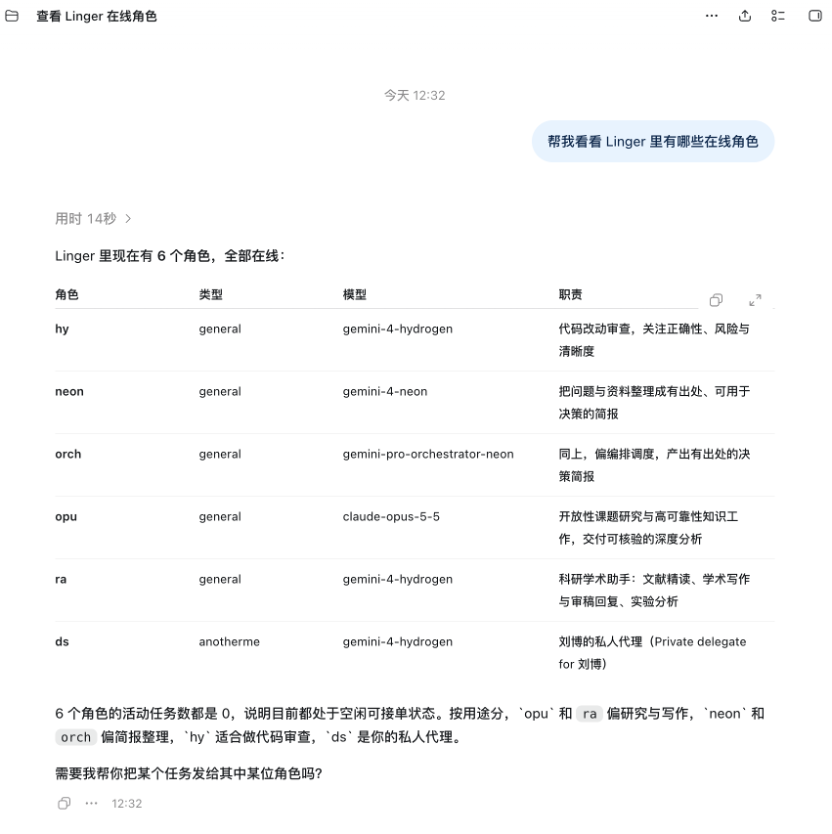
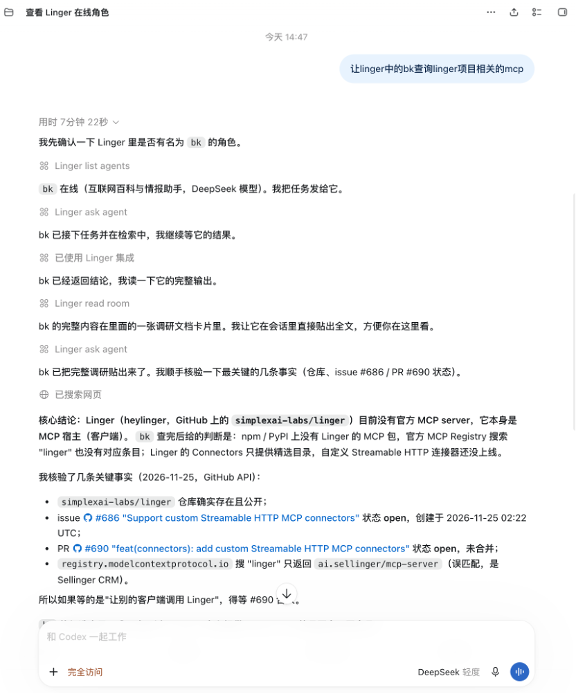
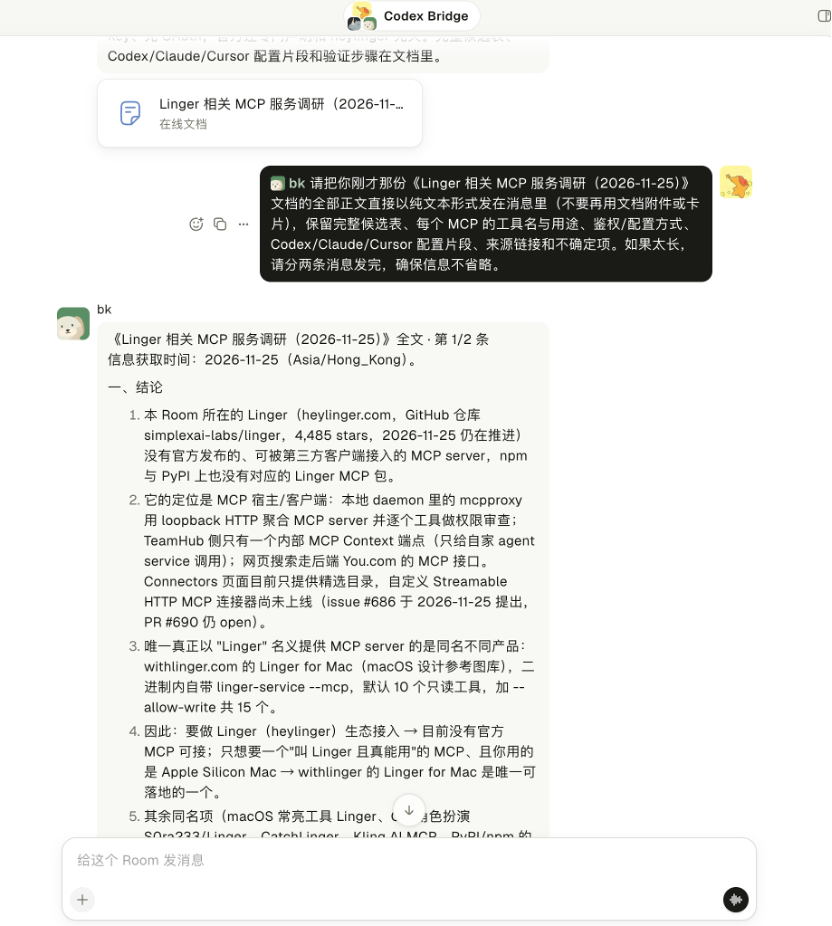
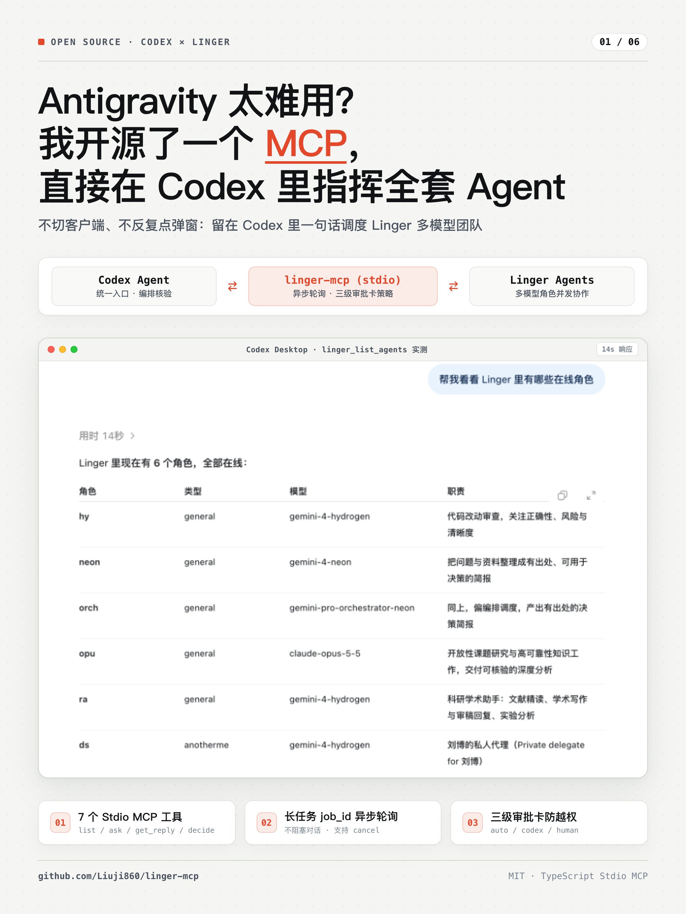
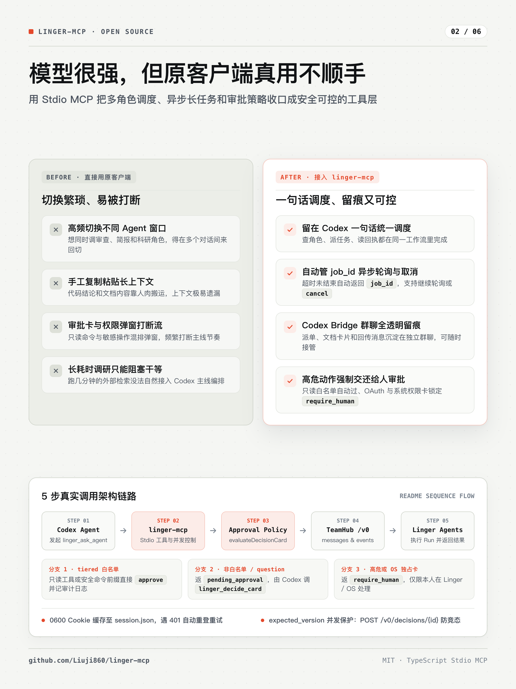
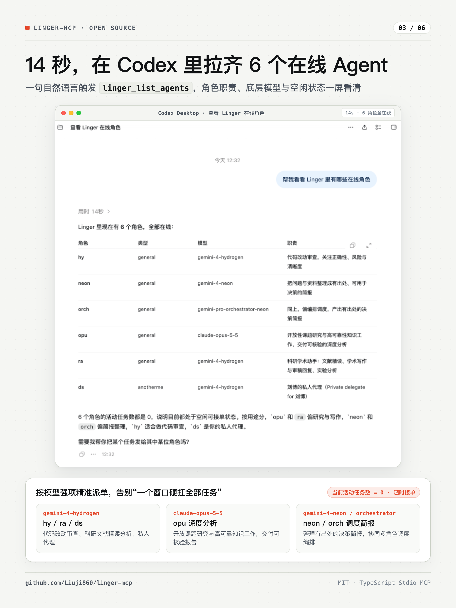
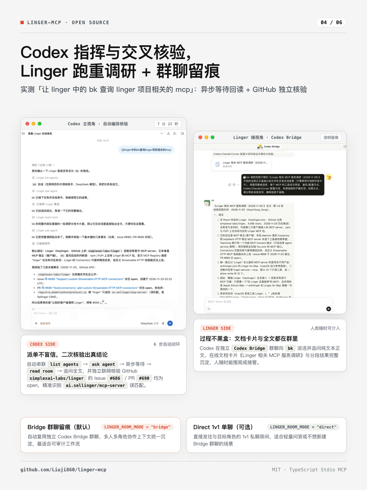
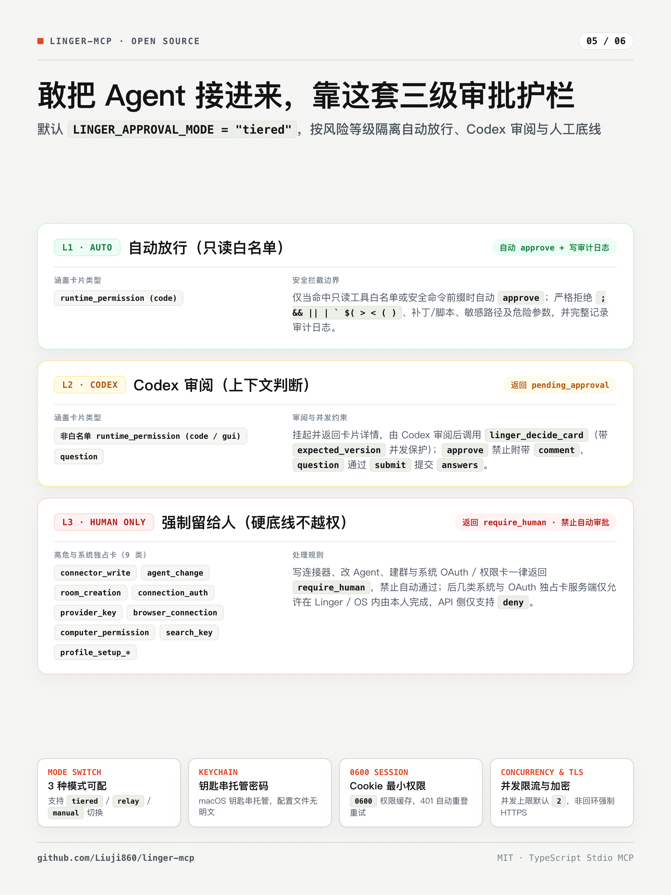
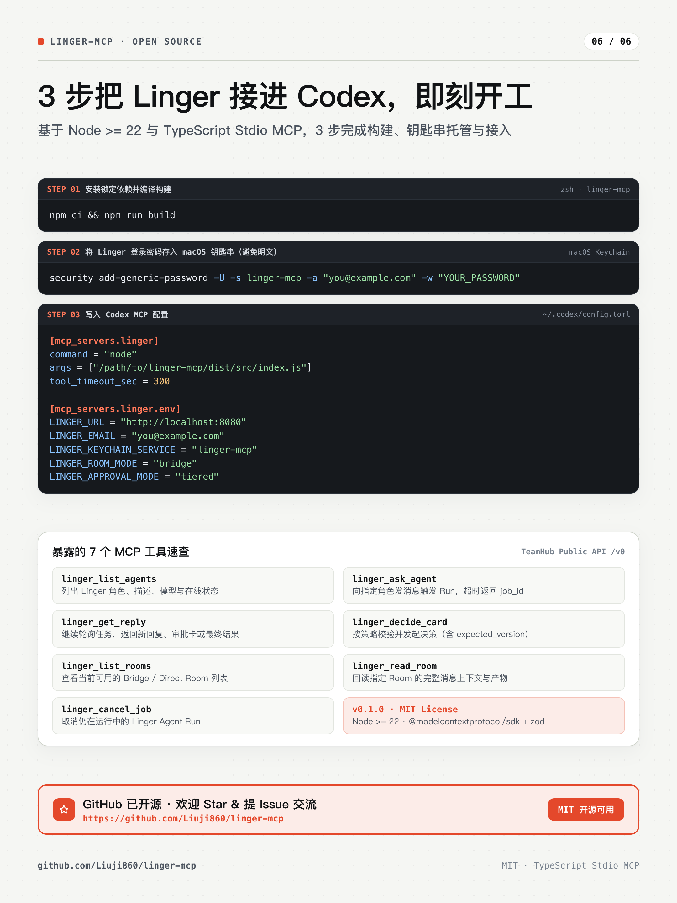
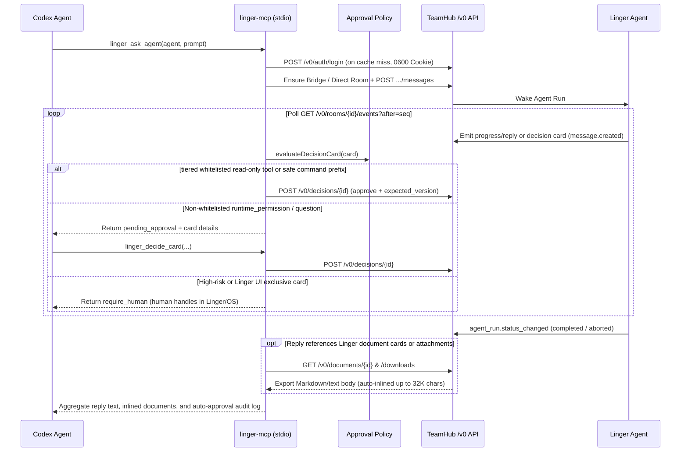

<div align="center">

# linger-mcp

**A stdio MCP server enabling Codex agents to orchestrate [Linger](https://github.com/simplexai-labs/linger) agents via TeamHub Public API with async job polling and tiered approval guardrails.**

[](https://github.com/Liuji860/linger-mcp/releases/tag/v0.1.1)
[](https://github.com/simplexai-labs/linger)


[](./LICENSE)

<br />

[简体中文](./README.md) &nbsp;|&nbsp; **English** &nbsp;|&nbsp; Official Project: [simplexai-labs/linger](https://github.com/simplexai-labs/linger)

<br />

[Highlights](#key-highlights) · [Live Demos](#live-usage-demos) · [Poster Gallery](#visual-overview-gallery) · [Architecture](#architecture-and-flow) · [Approval Policy](#tiered-approval-policy) · [Quick Start](#quick-start-with-codex) · [MCP Tools](#exposed-mcp-tools) · [Environment Variables](#environment-variables)

</div>

---

## Key Highlights

| Area | Details |
| --- | --- |
| **Stay Inside Codex** | Dispatch and inspect your full Linger multi-agent lineup directly from Codex without switching desktop windows or manually copy-pasting context across rooms. |
| **Non-Blocking Async Jobs** | Long-running delegations return a `job_id` when exceeding the initial wait window so Codex can poll via `linger_get_reply` or abort via `linger_cancel_job`, capped at `LINGER_MAX_CONCURRENCY=2` by default. |
| **Three-Tier Approval Guardrails** | Default `tiered` policy separates cards into `auto` (whitelisted read-only auto-approve), `codex` (pending Codex review), and `human` (hard-locked to Linger/OS), with `relay` and `manual` modes available. |
| **Keychain Security & Audit Trail** | Stores credentials in macOS Keychain with `0600` session cookie caching and automatic `401` re-login; defaults to a shared `Codex Bridge` room for full human visibility (or `direct` 1v1). |

---

## Live Usage Demos

### 1. List All Online Linger Agents and Models from Codex

Asking Codex to check online Linger agents calls `linger_list_agents` and returns every agent's type, underlying model (such as `gemini-4-hydrogen`, `gemini-4-neon`, `gemini-pro-orchestrator-neon`, `claude-opus-5-5`), responsibilities, and active task count in 14 seconds:

<p align="center">
  
</p>

### 2. Delegate Heavy Web Research to Linger and Cross-Check in Codex

Prompting Codex to have `bk` investigate MCP projects related to Linger chains `linger_list_agents` → `linger_ask_agent` → async polling → `linger_read_room` → follow-up full-text extraction, then independently cross-verifies GitHub Issue `#686`, PR `#690`, and registry false matches:

<p align="center">
  
</p>

### 3. Transparent `Codex Bridge` Trail in the Linger Client

In default `bridge` mode, every task dispatch, follow-up prompt, online Document card, and structured reply stays visible in the `Codex Bridge` room so you can inspect or intervene at any point:

<p align="center">
  
</p>

---

## Visual Overview Gallery

> Six high-resolution 3:4 overview posters (`2160 × 2880 px`) are archived under [`docs/posters/`](./docs/posters/) (click any thumbnail to open the full PNG):

<table>
  <tr>
    <td align="center" width="33%">
      <a href="./docs/posters/01-cover.png"></a><br />
      <sub><b>01 Cover</b> · Codex-First Control</sub>
    </td>
    <td align="center" width="33%">
      <a href="./docs/posters/02-pain-vs-solution.png"></a><br />
      <sub><b>02 Why linger-mcp</b> · 5-Step Architecture</sub>
    </td>
    <td align="center" width="33%">
      <a href="./docs/posters/03-demo-team.png"></a><br />
      <sub><b>03 Demo 1</b> · 6 Agents in 14s</sub>
    </td>
  </tr>
  <tr>
    <td align="center" width="33%">
      <a href="./docs/posters/04-demo-workflow.png"></a><br />
      <sub><b>04 Demo 2</b> · Delegation & Bridge Trail</sub>
    </td>
    <td align="center" width="33%">
      <a href="./docs/posters/05-security.png"></a><br />
      <sub><b>05 Guardrails</b> · 3-Tier Decision Policy</sub>
    </td>
    <td align="center" width="33%">
      <a href="./docs/posters/06-quickstart.png"></a><br />
      <sub><b>06 Quick Start</b> · 3 Steps & 8 Tools</sub>
    </td>
  </tr>
</table>

---

## Architecture and Flow



---

## Tiered Approval Policy

Uses `LINGER_APPROVAL_MODE=tiered` by default; can also be switched to `relay` or `manual`:

| Tier | Covered Card Types | Default Behavior | Guardrails & Rules |
| --- | --- | --- | --- |
| **Auto-Approve (`auto`)** | `runtime_permission` (`code`) | Automatically calls `approve` when matching whitelisted read-only tools or safe command prefixes | Rejects `; && \|\| \| \` $( > < ( )`, patches/scripts, sensitive paths, and dangerous flags; writes audit logs |
| **Codex Review (`codex`)** | Non-whitelisted `runtime_permission` (`code` / `gui`), `question` | Returns `pending_approval` for Codex to act via `linger_decide_card` | `approve` cannot include `comment`; `question` uses `submit` with `answers` |
| **Human-Only (`human`)** | `connector_write`, `agent_change`, `room_creation`, `connection_auth`, `provider_key`, `browser_connection`, `computer_permission`, `search_key`, `profile_setup_*` | Returns `require_human` and forbids auto-approval | System and OAuth cards are restricted server-side to Linger / OS completion; API supports `deny` only |

---

## Quick Start with Codex

### 1. Install dependencies and build

```bash
npm ci
npm run build
```

### 2. Optional: Store your Linger password in macOS Keychain

Avoid storing plaintext passwords in config files:

```bash
security add-generic-password -U -s linger-mcp -a "you@example.com" -w "YOUR_PASSWORD"
```

### 3. Add `[mcp_servers.linger]` to `~/.codex/config.toml`

```toml
[mcp_servers.linger]
command = "node"
args = ["/path/to/linger-mcp/dist/src/index.js"]
tool_timeout_sec = 300

[mcp_servers.linger.env]
LINGER_URL = "http://localhost:8080"
LINGER_EMAIL = "you@example.com"
LINGER_KEYCHAIN_SERVICE = "linger-mcp"
LINGER_ROOM_MODE = "bridge"
LINGER_APPROVAL_MODE = "tiered"
```

> [!NOTE]
> After the first successful login, `teamhub_session` cookies are cached at `~/.config/linger-mcp/session.json` with `0600` file permissions, and a `401` automatically triggers re-login and a single retry.

---

## Exposed MCP Tools

| Tool | Purpose |
| --- | --- |
| `linger_list_agents` | List Linger agents, descriptions, models, and online/active status |
| `linger_ask_agent` | Send a prompt to trigger an Agent Run (default `60s` wait) and auto-inline small/medium text or Markdown document cards |
| `linger_get_reply` | Poll job status (supports `wait_for_followup=true` for async follow-up deliveries on completed jobs), inlined docs, or pending cards |
| `linger_read_document` | Read/paginate full UTF-8 content by `document_id` or save large/binary files locally (`0600`) |
| `linger_decide_card` | Validate policy constraints and call `POST /v0/decisions/{id}` with `expected_version` concurrency protection |
| `linger_list_rooms` | List accessible Linger rooms |
| `linger_read_room` | Read recent message context from a target room |
| `linger_cancel_job` | Cancel an in-progress Linger Agent Run |

---

## Environment Variables

| Variable | Default / Requirement | Description |
| --- | --- | --- |
| `LINGER_URL` | **Required** | Linger TeamHub server URL (non-loopback addresses require `https://` unless `LINGER_ALLOW_INSECURE_HTTP=true` is explicitly set) |
| `LINGER_EMAIL` / `LINGER_PASSWORD` / `LINGER_KEYCHAIN_SERVICE` | Auth credentials | Account email and password (`LINGER_KEYCHAIN_SERVICE` is preferred on macOS over plaintext password) |
| `LINGER_LOCAL_IDENTITY_KEY` / `LINGER_LOCAL_IDENTITY_ORIGIN` | Optional | 32-byte Base64 key and Web Origin for validating `POST /v0/local/identity` on local setups |
| `LINGER_ROOM_MODE` | `bridge` | Room mode: `bridge` (dedicated `Codex Bridge` group room) or `direct` (1v1 direct chat) |
| `LINGER_DEFAULT_WAIT_SECONDS` | `60` | Default wait timeout in seconds per call (`0..300`) |
| `LINGER_AUTO_INLINE_DOCUMENTS` | `true` | Automatically fetch and inline text/Markdown document cards returned in replies |
| `LINGER_INLINE_DOCUMENT_MAX_CHARS` | `32768` | Maximum characters to inline per document or return per `linger_read_document` page |
| `LINGER_DOC_MAX_BYTES` | `10485760` | Maximum download byte limit per document (10 MiB) |
| `LINGER_DOWNLOAD_DIR` | `<tmpdir>/linger-mcp-downloads` | Target `0700` directory when `linger_read_document` runs with `save_to_file=true` |
| `LINGER_APPROVAL_MODE` | `tiered` | Approval policy mode: `tiered` \| `relay` \| `manual` |
| `LINGER_APPROVAL_ALLOW_TOOLS` | Preset read-only tools | Comma-separated allowlist of read-only tool names eligible for auto-approval |
| `LINGER_APPROVAL_ALLOW_CMD_PREFIXES` | Preset safe prefixes | Comma-separated allowlist of safe command prefixes |
| `LINGER_APPROVAL_DENY_PATTERNS` | Built-in dangerous rules | Extra regex deny patterns (JSON array format recommended, e.g. `["pattern1","pattern2"]`) |
| `LINGER_ALLOW_GUI_APPROVAL` | `false` | Whether whitelisted GUI actions may be auto-approved |
| `LINGER_ALLOW_HUMAN_CONFIRMED_RELAY` | `true` in `relay`, `false` in `tiered` | Whether high-risk cards may be relayed via MCP when `human_confirmed=true` |
| `LINGER_MAX_CONCURRENCY` | `2` | Maximum concurrent runs to avoid local model contention |

---

## Testing and License

```bash
npm run typecheck
npm test
```

Released under the [MIT License](./package.json).
