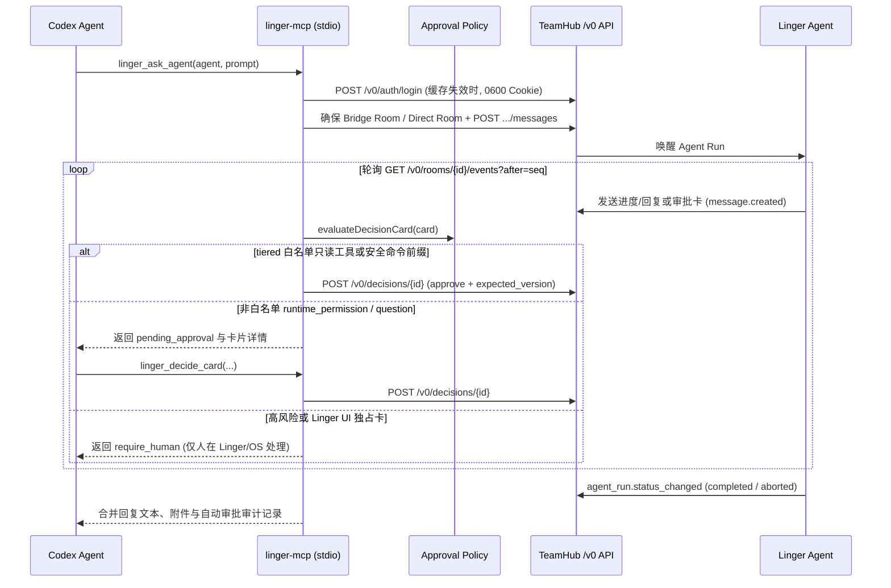

# linger-mcp

让 Codex Agent 通过 stdio MCP 调用 Linger 角色，并把长耗时异步任务与分级审批卡策略收口成安全可控的工具层。

## 架构与流程



## 审批卡分级策略（默认 `tiered`）

| 分级 | 涵盖卡片类型 | 默认行为 | 说明 |
| --- | --- | --- | --- |
| **自动放行 (`auto`)** | `runtime_permission` (`code`) | 满足白名单且无高危语法/参数时自动 `approve` | 拒绝 `; && \|\| \| \` $( > < ( )`、补丁/脚本、敏感路径及危险参数；记录审计日志 |
| **Codex 审阅 (`codex`)** | 非白名单 `runtime_permission` (`code` / `gui`)、`question` | 返回 `pending_approval`，由 Codex 调用 `linger_decide_card` 批复或答复 | `approve` 不允许附带 `comment`；`question` 用 `submit` 传 `answers` |
| **强制留给人 (`human`)** | `connector_write`、`agent_change`、`room_creation`、`connection_auth`、`provider_key`、`browser_connection`、`computer_permission`、`search_key`、`profile_setup_*` | 返回 `require_human`，禁止自动审批 | 后几类系统/OAuth 卡服务端仅允许在 Linger/OS 完成，接口仅支持 `deny` |

可通过环境变量 `LINGER_APPROVAL_MODE=tiered|relay|manual` 切换为仅转发确认或全人工模式。

## 快速接入 Codex

1. 构建项目（使用锁定的依赖版本）：

```bash
npm ci
npm run build
```

2. 可选：将 Linger 登录密码存入 macOS 钥匙串（避免在配置文件中写明文密码）：

```bash
security add-generic-password -U -s linger-mcp -a "you@example.com" -w "YOUR_PASSWORD"
```

3. 在 `~/.codex/config.toml` 中添加：

```toml
[mcp_servers.linger]
command = "node"
args = ["/path/to/linger-mcp/dist/src/index.js"]
tool_timeout_sec = 300

[mcp_servers.linger.env]
LINGER_URL = "http://localhost:8080"
LINGER_EMAIL = "you@example.com"
LINGER_KEYCHAIN_SERVICE = "linger-mcp"
LINGER_ROOM_MODE = "bridge"
LINGER_APPROVAL_MODE = "tiered"
```

> 首次登录成功后会将 `teamhub_session` Cookie 缓存在 `~/.config/linger-mcp/session.json`（权限 `0600`），遇到 `401` 会自动重新登录并重试一次。

## 暴露的 MCP 工具

- `linger_list_agents`：列出 Linger 中的角色、描述、模型与在线状态
- `linger_ask_agent`：向指定角色发消息触发 Run，超时未结束则返回 `job_id`
- `linger_get_reply`：继续轮询任务状态，返回新回复、挂起审批卡或最终结果
- `linger_decide_card`：按策略校验并发起 `POST /v0/decisions/{id}`（含 `expected_version` 并发保护）
- `linger_list_rooms` / `linger_read_room`：查看 Room 列表与消息上下文
- `linger_cancel_job`：取消运行中的 Linger Agent Run

## 环境变量说明

- `LINGER_URL`（必填）：Linger TeamHub 服务地址（非回环地址必须使用 `https://`，除非显式设置 `LINGER_ALLOW_INSECURE_HTTP=true`）
- `LINGER_EMAIL` / `LINGER_PASSWORD` / `LINGER_KEYCHAIN_SERVICE`：账号与密码（优先用钥匙串）
- `LINGER_LOCAL_IDENTITY_KEY` / `LINGER_LOCAL_IDENTITY_ORIGIN`（可选）：本地安装时校验 `POST /v0/local/identity` 的 32 字节 Base64 密钥与 Web Origin
- `LINGER_ROOM_MODE`：`bridge`（默认，使用独立 `Codex Bridge` 群聊）或 `direct`（1v1 单聊）
- `LINGER_APPROVAL_MODE`：`tiered`（默认）| `relay` | `manual`
- `LINGER_APPROVAL_ALLOW_TOOLS`：逗号分隔允许自动放行的只读工具名
- `LINGER_APPROVAL_ALLOW_CMD_PREFIXES`：逗号分隔允许自动放行的命令前缀
- `LINGER_APPROVAL_DENY_PATTERNS`：额外禁止自动放行的正则（推荐 JSON 数组格式，如 `["pattern1","pattern2"]`）
- `LINGER_ALLOW_GUI_APPROVAL`：是否允许白名单内的 GUI 操作自动审批（默认 `false`）
- `LINGER_ALLOW_HUMAN_CONFIRMED_RELAY`：是否允许在带 `human_confirmed=true` 时经由 MCP 转发高风险卡（`relay` 模式默认 `true`，`tiered` 模式默认 `false`）
- `LINGER_MAX_CONCURRENCY`：并发任务上限（默认 `2`，防止本地模型抢占）

## 测试

```bash
npm run typecheck
npm test
```
