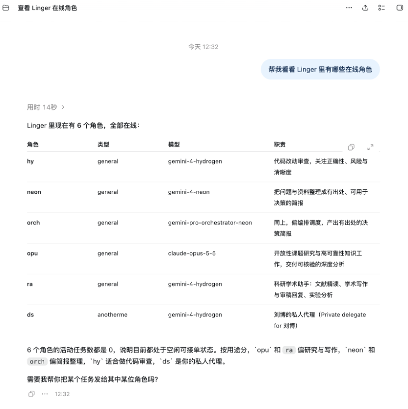
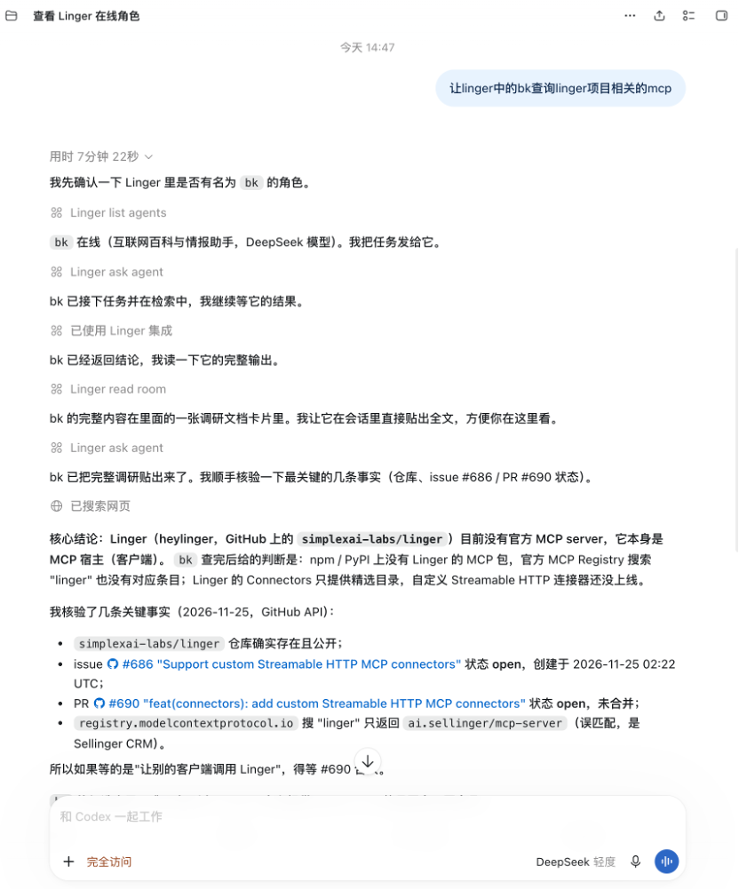
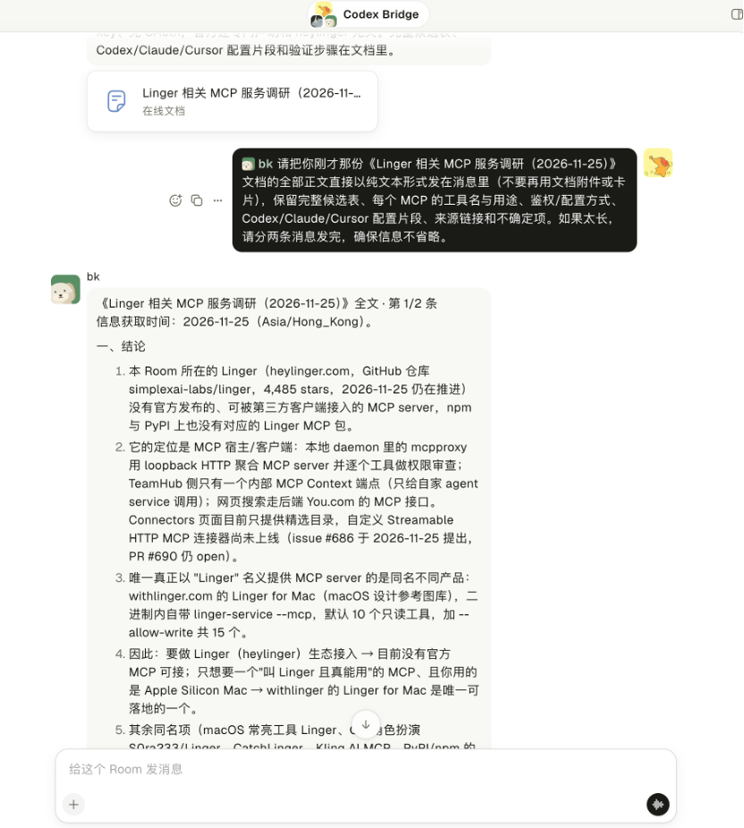
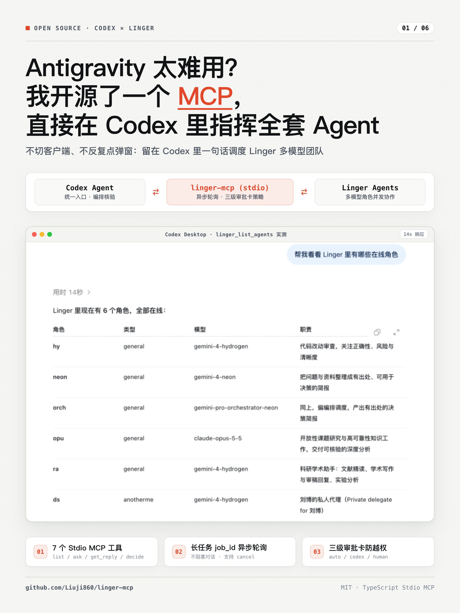
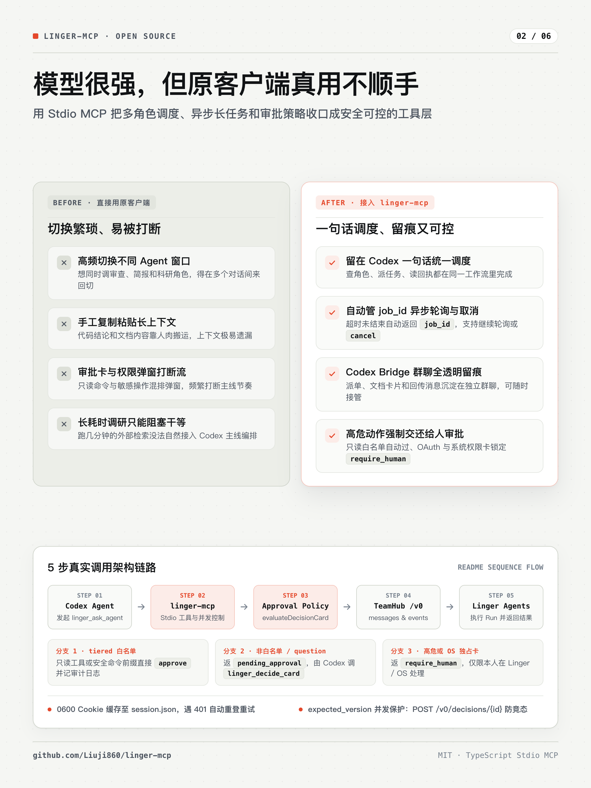
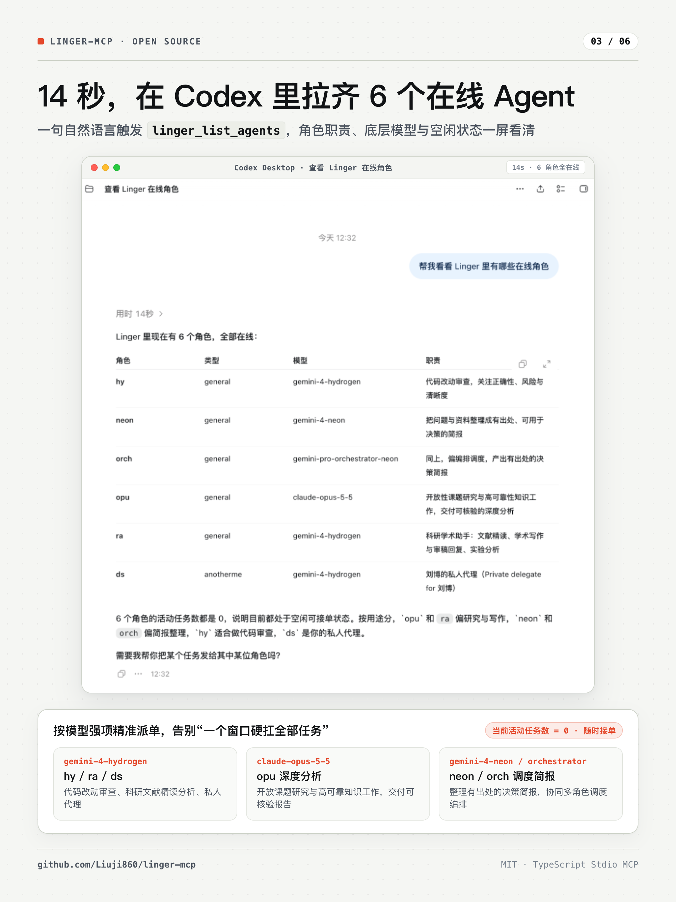
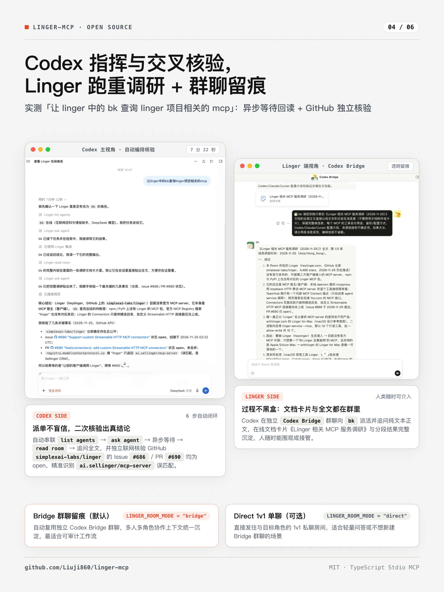
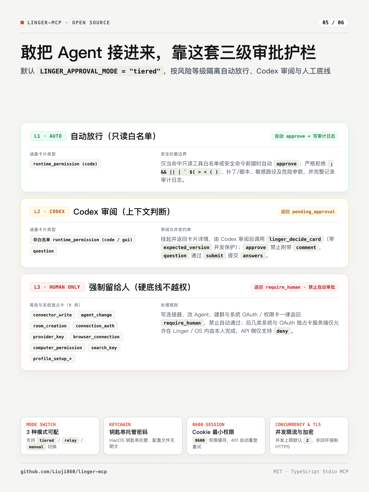
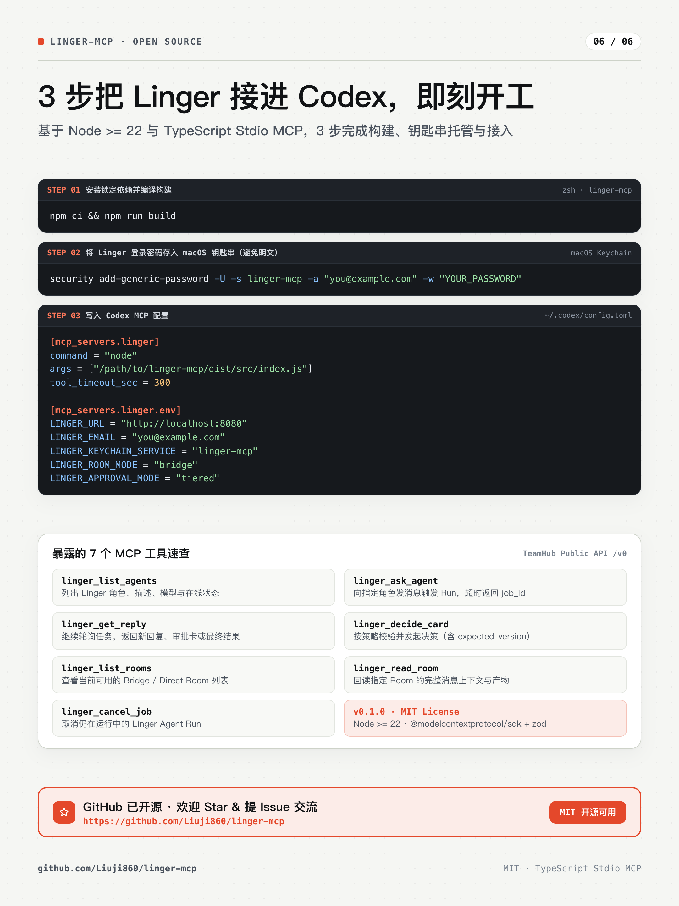
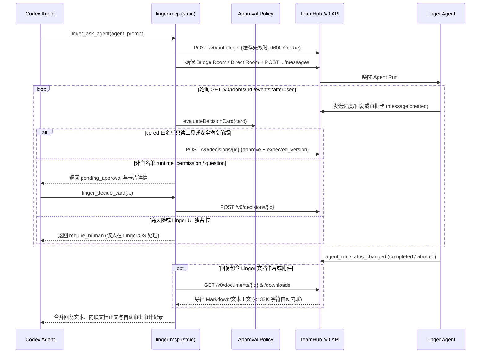

<div align="center">

# linger-mcp

**让 Codex Agent 通过 stdio MCP 无缝调度 [Linger](https://github.com/simplexai-labs/linger) 全套角色，将长耗时异步任务与分级审批策略收口成安全可控的工具层。**

[](https://github.com/Liuji860/linger-mcp/releases/tag/v0.1.1)
[](https://github.com/simplexai-labs/linger)


[](./LICENSE)

<br />

**简体中文** &nbsp;|&nbsp; [English](./README.en.md) &nbsp;|&nbsp; 官方项目：[simplexai-labs/linger](https://github.com/simplexai-labs/linger)

<br />

[核心亮点](#核心亮点) · [实测截图](#实际应用效果) · [图文海报](#项目图文海报) · [架构流程](#架构与流程) · [审批策略](#审批卡分级策略) · [快速接入](#快速接入-codex) · [工具清单](#暴露的-mcp-工具) · [环境变量](#环境变量说明)

</div>

---

## 核心亮点

| 维度 | 说明 |
| --- | --- |
| **留在 Codex 统一指挥** | 不用在 Antigravity 客户端多个角色对话间来回切窗口、手动搬运上下文，一句话查看并调度 Linger 在线团队。 |
| **长任务异步不阻塞** | `linger_ask_agent` 超时未结束自动返回 `job_id`，配合 `linger_get_reply` 与 `linger_cancel_job` 轮询或随时取消；默认并发上限 `LINGER_MAX_CONCURRENCY=2`。 |
| **三级审批防越权** | 默认 `tiered` 模式将审批卡拆为 `auto`（白名单只读自动放行）、`codex`（非白名单交 Codex 审阅）、`human`（高危与系统独占卡强制人工确认），并支持 `relay` / `manual` 切换。 |
| **凭据安全与透明留痕** | 支持 macOS 钥匙串托管密码、`0600` 权限 Session Cookie 自动续期；默认在独立 `Codex Bridge` 群聊沉淀全流程（可切换 `direct` 1v1 单聊）。 |

---

## 实际应用效果

### 1. 在 Codex 中一句话查看 Linger 在线角色与模型

直接询问「帮我看看 Linger 里有哪些在线角色」，通过 `linger_list_agents` 在 14 秒内列出全员类型、底层模型（如 `gemini-4-hydrogen`、`gemini-4-neon`、`gemini-pro-orchestrator-neon`、`claude-opus-5-5`）与空闲状态：

<p align="center">
  
</p>

### 2. Codex 自动调度 Linger 角色跑重调研并交叉核验

输入「让 linger 中的 bk 查询 linger 项目相关的 mcp」，Codex 自动串联 `linger_list_agents` → `linger_ask_agent` → 异步轮询 → `linger_read_room` → 追问贴出全文，并独立联网核验 GitHub Issue `#686` / PR `#690` 与同名误匹配项后输出结论：

<p align="center">
  
</p>

### 3. Linger 侧 `Codex Bridge` 群聊全程透明留痕

默认 `bridge` 模式下，Codex 与 Linger 角色之间的派单、追问、在线文档卡片与结构化正文都会实时沉淀在 `Codex Bridge` 群聊中，人类可随时查看或直接接管：

<p align="center">
  
</p>

---

## 项目图文海报

> 配套 6 张 3:4 图文海报（`2160 × 2880 px`）已收入 [`docs/posters/`](./docs/posters/)，点击任意一张可查看原图：

<table>
  <tr>
    <td align="center" width="33%">
      <a href="./docs/posters/01-cover.png"></a><br />
      <sub><b>01 痛点封面</b> · Codex 统一指挥</sub>
    </td>
    <td align="center" width="33%">
      <a href="./docs/posters/02-pain-vs-solution.png"></a><br />
      <sub><b>02 痛点对比</b> · 5 步真实链路</sub>
    </td>
    <td align="center" width="33%">
      <a href="./docs/posters/03-demo-team.png"></a><br />
      <sub><b>03 实测 1</b> · 14 秒拉齐 6 角色</sub>
    </td>
  </tr>
  <tr>
    <td align="center" width="33%">
      <a href="./docs/posters/04-demo-workflow.png"></a><br />
      <sub><b>04 实测 2</b> · Codex 核验 + Bridge 留痕</sub>
    </td>
    <td align="center" width="33%">
      <a href="./docs/posters/05-security.png"></a><br />
      <sub><b>05 安全护栏</b> · 三级审批隔离</sub>
    </td>
    <td align="center" width="33%">
      <a href="./docs/posters/06-quickstart.png"></a><br />
      <sub><b>06 快速上手</b> · 3 步接入 + 8 工具</sub>
    </td>
  </tr>
</table>

---

## 架构与流程



---

## 审批卡分级策略

默认使用 `LINGER_APPROVAL_MODE=tiered`，可通过环境变量切换为 `relay`（转发确认）或 `manual`（全人工模式）：

| 分级 | 涵盖卡片类型 | 默认行为 | 说明与约束 |
| --- | --- | --- | --- |
| **自动放行 (`auto`)** | `runtime_permission` (`code`) | 满足只读白名单或安全命令前缀时自动 `approve` | 拒绝 `; && \|\| \| \` $( > < ( )`、补丁/脚本、敏感路径及危险参数；全程记录审计日志 |
| **Codex 审阅 (`codex`)** | 非白名单 `runtime_permission` (`code` / `gui`)、`question` | 返回 `pending_approval`，由 Codex 调用 `linger_decide_card` 批复或答复 | `approve` 不允许附带 `comment`；`question` 使用 `submit` 传入 `answers` |
| **强制留给人 (`human`)** | `connector_write`、`agent_change`、`room_creation`、`connection_auth`、`provider_key`、`browser_connection`、`computer_permission`、`search_key`、`profile_setup_*` | 返回 `require_human`，禁止自动审批 | 后几类系统/OAuth 卡服务端仅允许在 Linger / OS 完成，接口仅支持 `deny` |

---

## 快速接入 Codex

### 1. 安装依赖并构建项目

```bash
npm ci
npm run build
```

### 2. 可选：将 Linger 登录密码存入 macOS 钥匙串

避免在配置文件中写入明文密码：

```bash
security add-generic-password -U -s linger-mcp -a "you@example.com" -w "YOUR_PASSWORD"
```

### 3. 在 `~/.codex/config.toml` 中添加 MCP 配置

```toml
[mcp_servers.linger]
command = "node"
args = ["/path/to/linger-mcp/dist/src/index.js"]
tool_timeout_sec = 300

[mcp_servers.linger.env]
LINGER_URL = "http://localhost:8080"
LINGER_EMAIL = "you@example.com"
LINGER_KEYCHAIN_SERVICE = "linger-mcp"
LINGER_ROOM_MODE = "bridge"
LINGER_APPROVAL_MODE = "tiered"
```

> [!NOTE]
> 首次登录成功后会将 `teamhub_session` Cookie 缓存在 `~/.config/linger-mcp/session.json`（权限 `0600`），遇到 `401` 会自动重新登录并重试一次。

---

## 暴露的 MCP 工具

| 工具名 | 用途 |
| --- | --- |
| `linger_list_agents` | 列出 Linger 中的角色、描述、模型与在线状态 |
| `linger_ask_agent` | 向指定角色发消息触发 Run（默认等待 `60s`），自动内联回复中的中小文本/Markdown 文档卡片正文 |
| `linger_get_reply` | 轮询任务状态（支持 `wait_for_followup=true` 等待已完成任务后续异步投递的结果），返回新回复、内联文档与挂起审批卡 |
| `linger_read_document` | 读取/分页查看指定 `document_id` 完整正文，或将大文件/二进制附件落盘到本地（`0600`） |
| `linger_decide_card` | 按策略校验并发起 `POST /v0/decisions/{id}`（含 `expected_version` 并发保护） |
| `linger_list_rooms` | 查看当前可见的 Room 列表 |
| `linger_read_room` | 读取指定 Room 的历史与最新消息上下文 |
| `linger_cancel_job` | 取消运行中的 Linger Agent Run |

---

## 环境变量说明

| 变量 | 默认值 / 要求 | 说明 |
| --- | --- | --- |
| `LINGER_URL` | **必填** | Linger TeamHub 服务地址（非回环地址必须使用 `https://`，除非显式设置 `LINGER_ALLOW_INSECURE_HTTP=true`） |
| `LINGER_EMAIL` / `LINGER_PASSWORD` / `LINGER_KEYCHAIN_SERVICE` | 按认证方式配置 | 登录账号与密码（推荐优先使用 `LINGER_KEYCHAIN_SERVICE` 从 macOS 钥匙串读取） |
| `LINGER_LOCAL_IDENTITY_KEY` / `LINGER_LOCAL_IDENTITY_ORIGIN` | 可选 | 本地安装时校验 `POST /v0/local/identity` 的 32 字节 Base64 密钥与 Web Origin |
| `LINGER_ROOM_MODE` | `bridge` | 会话房间模式：`bridge`（独立 `Codex Bridge` 群聊）或 `direct`（1v1 单聊） |
| `LINGER_DEFAULT_WAIT_SECONDS` | `60` | 单次等待回复超时秒数（范围 `0..300`） |
| `LINGER_AUTO_INLINE_DOCUMENTS` | `true` | 是否自动内联回复中的文本/Markdown 文档卡片正文 |
| `LINGER_INLINE_DOCUMENT_MAX_CHARS` | `32768` | 单篇自动内联与 `linger_read_document` 分页单次最大字符数 |
| `LINGER_DOC_MAX_BYTES` | `10485760` | 单文档下载大小上限（10 MiB） |
| `LINGER_DOWNLOAD_DIR` | `<tmpdir>/linger-mcp-downloads` | `linger_read_document` 开启 `save_to_file=true` 时的本地保存目录（权限 `0700`） |
| `LINGER_APPROVAL_MODE` | `tiered` | 审批策略模式：`tiered` \| `relay` \| `manual` |
| `LINGER_APPROVAL_ALLOW_TOOLS` | 预设只读工具 | 逗号分隔允许自动放行的只读工具名 |
| `LINGER_APPROVAL_ALLOW_CMD_PREFIXES` | 预设安全前缀 | 逗号分隔允许自动放行的命令前缀 |
| `LINGER_APPROVAL_DENY_PATTERNS` | 内置高危规则 | 额外禁止自动放行的正则（推荐 JSON 数组格式，如 `["pattern1","pattern2"]`） |
| `LINGER_ALLOW_GUI_APPROVAL` | `false` | 是否允许白名单内的 GUI 操作自动审批 |
| `LINGER_ALLOW_HUMAN_CONFIRMED_RELAY` | `relay` 为 `true`，`tiered` 为 `false` | 是否允许在带 `human_confirmed=true` 时经由 MCP 转发高风险卡 |
| `LINGER_MAX_CONCURRENCY` | `2` | 并发任务上限，防止本地模型资源抢占 |

---

## 测试与许可

```bash
npm run typecheck
npm test
```

本项目基于 [MIT](./package.json) 协议开源。
